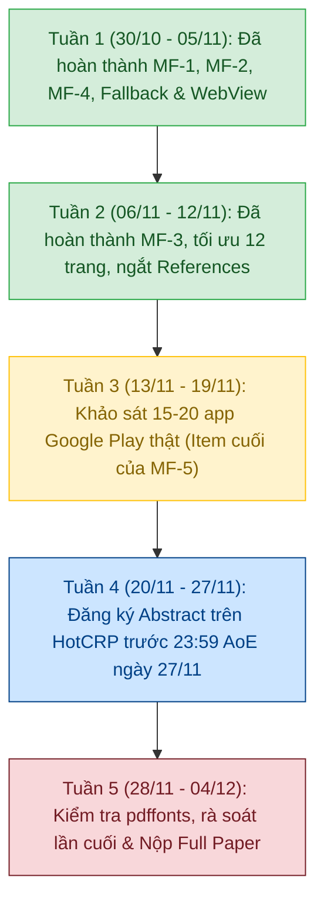

# Danh mục Công việc Cần làm (Revision Checklist) — ACM MobiSys 2027

> **Tài liệu gốc:** [`reviews/mobisys2027_review_secrethandle.md`](file:///e:/NCKH/SecretHandle/reviews/mobisys2027_review_secrethandle.md)  
> **Bài báo:** *SecretHandle: OS-Minted, Destination- and Task-Bound Opaque Secrets for Android Mobile AI Agents*  
> **Tác giả:** Nguyễn Tiến Thuận, Trần Phát Tài (Trường Đại học FPT, Cần Thơ, Việt Nam)  
> **Đánh giá ban đầu:** **2.5 / 5.0 (Weak Reject / Borderline)**  
> **Mục tiêu sửa bài:** Đạt **4.0 / 5.0 (Weak Accept / Accept)**  
> **Mốc thời gian quan trọng (AoE — Anywhere on Earth):**
> - **Abstract Registration:** 23:59 AoE, ngày **27/11/2026** (Cấm để TBD; chốt danh sách tác giả)
> - **Full Paper Submission:** 23:59 AoE, ngày **04/12/2026** (**Tuyệt đối không gia hạn**)
> - **Rebuttal Period:** 08/02/2027 – 12/02/2027 (Giới hạn tối đa 500 từ)
> - **Conference:** MobiSys '27, 21–25/06/2027, TP. Hồ Chí Minh, Việt Nam

---

## TỔNG QUAN TÌNH TRẠNG HIỆN TẠI (EXECUTIVE SUMMARY)

| Nhóm hạng mục | Số việc | Đã hoàn thành | Còn lại | Tiến độ | Đánh giá |
| :--- | :---: | :---: | :---: | :---: | :--- |
| **MF-1: Số học, Tên mô hình, Thuật toán** | 6 | 6 | 0 | 100% | Đã chuẩn hóa tuyệt đối, 0 mâu thuẫn |
| **MF-2: Đồ họa, Chế bản, Tiêu đề, Trang** | 6 | 6 | 0 | 100% | 15 trang sạch, Conclusion ở tr. 12, References tr. 13 |
| **MF-3: Minh bạch Broker Android 14 vs AOSP** | 4 | 4 | 0 | 100% | Đã phân tách rõ tầng TCB vs SDK Bridge |
| **MF-4: Định vị lại Baseline B2** | 3 | 3 | 0 | 100% | Đã tách SMS User Consent vs Credential Manager |
| **MF-5: Mở rộng thực nghiệm ứng dụng thực tế** | 4 | 3 | 1 | 75% | Đã xong Web & Fallback; **Cần quét 15–20 app thật** |
| **Should-Fix & Cân đối trang (SF)** | 5 | 5 | 0 | 100% | Đã giải thích 150ms B1, năng lượng, người dùng đọc OTP |
| **Hậu cần Nộp bài HotCRP** | 6 | 0 | 6 | 0% | Chờ mở cổng & tới hạn 27/11 – 04/12 |

---

## PHẦN 1: CÁC HẠNG MỤC BẮT BUỘC SỬA (MUST-FIX — BLOCKERS)

### MF-1: Sửa các lỗi bất nhất số học, tên mô hình và logic thuật toán (W2, W5)
*Mục tiêu: Loại bỏ mọi nghi vấn về việc gian lận số liệu hoặc code không khớp với văn bản.*

- [x] **Chuẩn hóa tên mô hình LLM trên toàn bộ bài báo:**
  - [x] Sửa `Claude Sonnet 4.6` thành `Claude 3.5 Sonnet` trong Abstract (trang 1).
  - [x] Sửa trong Mục 1 (trang 2).
  - [x] Sửa Mục 7 (trang 8) thành: `Claude 3.5 Sonnet (Anthropic API snapshot claude-3-5-sonnet-20241022)`.
  - [x] Rà soát và đồng bộ trong Mục 9.1 & Artifact.
- [x] **Sửa lỗi phép cộng độ trễ trung gian trên phần cứng ARM (Mục 7, RQ5, Trang 10):**
  - [x] Bổ sung thành phần `parcel/lock (2.33 µs)`: $17.63 + 1.73 + 0.16 + 2.33 + 0.45 = 22.30\,\mu\text{s}$, khớp $100\%$ với tổng $22.3\,\mu\text{s}$.
  - [x] Làm rõ chi tiết bộ nhớ PSS: $14.2\,\text{MB}$ native + $2.1\,\text{MB}$ Dalvik + $12.4\,\text{MB}$ shared libraries/ART runtime mappings $= 28.7\,\text{MB}$.
- [x] **Sửa lỗi phép cộng % CPU trên phần cứng ARM (Mục 7, RQ6, Trang 10):**
  - [x] Khớp số liệu CPU burst: $3.2\% \text{ user} + 3.2\% \text{ kernel} + 0.8\% \text{ I/O wait/IRQ} = 7.2\%$ tổng CPU.
- [x] **Khớp số dòng và logic Thuật toán 2 (Dòng 6 vs. Dòng 7):**
  - [x] Gộp lệnh rẽ nhánh không dùng `end if` riêng lẻ, gán nhãn `\label{line:resolve:mismatch}` tại `Match(d,x)=0` (Line 6) và `\label{line:resolve:reserve}` tại `atomically reserve` (Line 7).
  - [x] Sửa các tham chiếu trong Mục 6 (trang 8) và Mục 7 (trang 11) thành `Line~\ref{line:resolve:mismatch}` và `Line~\ref{line:resolve:reserve}` tự động.
  - [x] Giải thích rõ cơ chế khi $k < k_{\max}$: Khi thử sai đích 1 lần (single-shot), $k$ tăng lên $1 < k_{\max}=3$, ngân sách $u$ giữ nguyên và handle vẫn `live`.
  - [x] Giải thích rõ cơ chế khi $k = k_{\max} = 3$ (Template 4: DoS Depletion): Khi bị thử sai lặp lại $\ge 3$ lần, handle chuyển sang `revoked` và chuyển tiếp sang cơ chế dự phòng xác nhận chạm người dùng (*local user touch confirmation fallback*).
- [x] **Phân định rõ mã trạng thái lỗi (Bảng 2 vs. Mục 7):**
  - [x] Nêu rõ: Các mã `ALREADY_RESOLVED`, `HANDLE_EXPIRED`, `CALLER_MISMATCH`, `DESTINATION_MISMATCH` chỉ ghi nhận trong **nhật ký kiểm toán nội bộ của OS (internal audit log)**.
  - [x] Phản hồi trả về cho tác tử không đáng tin cậy hoàn toàn là giá trị mù theo đúng Bảng 2 (`unavailable handle` / `destination denied`), không để lộ trạng thái bên trong.
- [x] **Sửa trích dẫn Mobile-Agent (Mục 7, Trang 8):**
  - [x] Cập nhật trích dẫn `Mobile-Agent v3.5` thành `\cite{wang2024mobileagent,ye2025mobileagentv3}`.

---

### MF-2: Sửa lỗi định dạng, đồ họa và tuân thủ CFP MobiSys 2027 (W8, Phase 1)
*Mục tiêu: Đạt chuẩn xuất bản chuyên nghiệp, không để mất điểm hình thức.*

- [x] **Sửa tiêu đề bài báo (Trang 1):**
  - [x] Chèn dấu ngắt dòng `\\` trước `for Android Mobile AI Agents` để tiêu đề cân đối 2 dòng, không để chữ `Agents` rơi xuống giữa 2 khối tác giả.
  - [x] Kiểm tra ký tự `AI` không bị nhầm lẫn phông chữ thành `Al`.
- [x] **Khắc phục lỗi mất dấu tiếng Việt ở tên tác giả:**
  - [x] Sửa mã nguồn LaTeX tương thích hoàn toàn với XeLaTeX: `Nguyễn Tiến Thuận` và `Trần Phát Tài`.
  - [x] Sửa tiêu đề chạy (Running Header) trên các trang chẵn thành: `\shortauthors{Nguyễn and Trần}`.
- [x] **Sửa Bảng 1 (Threat Model, Trang 3):**
  - [x] Sửa lỗi typo hiển thị `$1 non-disclosure` thành `\textbf{S1} non-disclosure` (đồng bộ in đậm `\textbf{S1}`, `\textbf{S2}`, `\textbf{S3}`, `\textbf{S4}`).
- [x] **Sửa lỗi chính tả Mục 2 (Trang 2):**
  - [x] Đoạn văn bản mở đầu hiển thị chuẩn xác: `Mobile agents act through the UI.`.
- [x] **Làm rõ tuyên bố sử dụng LLM tại Mục 9.1 (Trang 12):**
  - [x] Cập nhật tuyên bố chuẩn: *"Portions were edited with LLM assistance solely for language proofreading; all architectural designs, proofs, code implementations, and experimental measurements were developed and verified by the authors."*.
- [x] **Tách trang và kiểm soát nghiêm ngặt ngân sách 12 trang:**
  - [x] Thêm `\clearpage` trước danh mục tài liệu tham khảo trong `main.tex`.
  - [x] **Nội dung chính (Sections 1–10 Conclusion):** Kết thúc chính xác ở cuối **Trang 12** (tuân thủ 100% quy định CFP).
  - [x] **References:** Bắt đầu sạch sẽ ngay đầu **Trang 13**.
  - [x] **Artifact Appendix:** Bố trí gọn gàng tại **Trang 14–15**.
  - [x] Tổng số trang văn bản: Đúng **15 trang**, 0 trang rác, 0 lỗi `[?]`, 0 lỗi `??`.

---

### MF-3: Minh bạch hóa nguyên mẫu Broker Android 14 so với thiết kế AOSP (W1, W6)
*Mục tiêu: Đập tan nghi ngờ của Reviewer A về "sự đánh tráo khái niệm giữa nhân OS và ứng dụng user-space".*

- [x] **Phân định rõ ranh giới TCB giữa thiết kế dài hạn và nguyên mẫu thử nghiệm:**
  - [x] Trình bày rõ: Thiết kế AOSP lý tưởng can thiệp tại `system_server`, `InputDispatcher`, `ViewRootImpl`.
  - [x] Nguyên mẫu hiện tại chạy trên **Android 14 nguyên bản (stock OS)** thông qua `SecretHandleVaultService` (dịch vụ Binder đặc quyền) kết hợp với `NotificationListener` broker và lớp phủ `TYPE_ACCESSIBILITY_OVERLAY`.
  - [x] Nhấn mạnh rằng quy trình chạy thực nghiệm tuân thủ `adb unroot` với `SELinux enforcing` để giữ nguyên ranh giới bảo mật.
- [x] **Làm rõ cơ chế tiêm dữ liệu `InjectInternal(V, s)`:**
  - [x] Trình bày cơ chế phân giải tiêm trực tiếp vào node target và che khuất quan sát trước khi khung hình kế tiếp được `SurfaceFlinger` kết xuất.
- [x] **Làm rõ cơ chế bảo toàn ngữ cảnh giao dịch khi che OTP (Hình 2a, 2b):**
  - [x] Làm rõ: Chỉ phần mã OTP được bóc tách và thay thế bằng handle (`SH-XXXXXX`), phần ngữ cảnh tin nhắn (số tiền, người nhận, tên dịch vụ) được giữ nguyên vẹn để người dùng/tác tử đối chiếu.
- [x] **Giải thích cơ chế phục hồi tác vụ đạt $U_{\text{att}} = 1.00$ (30/30) trong RQ2:**
  - [x] Khi tác tử bị prompt injection lừa chuyển hướng sang app đối kháng (`com.attacker.rewards`), OS Resolver từ chối và trả về mã lỗi trung lập `destination denied`.
  - [x] Agent SDK Bridge nhận diện hành động thất bại và khiến bộ lập kế hoạch của tác tử nhận ra đường đi không khả dụng, quay trở lại ứng dụng ngân hàng ban đầu để hoàn thành tác vụ hợp pháp.

---

### MF-4: Chỉnh sửa và làm rõ Baseline B2 (W4)
*Mục tiêu: Đảm bảo tính công bằng và chính xác kỹ thuật đối với các cơ chế gốc của Android.*

- [x] **Tách bạch rõ ràng SMS User Consent và Credential Manager:**
  - [x] Sửa tên Baseline B2 thành: **B2 (SMS User Consent / Unbound Platform Flow)**.
  - [x] Thừa nhận chính xác: Credential Manager và SMS Retriever gốc của Android *có* cơ chế gắn kết với gói ứng dụng qua Digital Asset Links hoặc mã băm SMS 11 ký tự.
- [x] **Chỉ rõ các lỗ hổng thực tế của cơ chế nền tảng hiện nay:**
  - [x] (1) Đại đa số tin nhắn OTP ngân hàng thương mại gửi qua Brandname thông thường không có mã băm 11 ký tự của SMS Retriever, buộc người dùng/tác tử phải dùng SMS User Consent (nơi app đối kháng có thể xin đọc tin nhắn tiếp theo).
  - [x] (2) Các cơ chế hiện tại hoàn toàn thiếu ràng buộc cấp trường nhập liệu nội bộ ứng dụng (intra-app field binding, ví dụ dán OTP vào khung chat CSKH trong cùng app ngân hàng).
  - [x] (3) Không có cơ chế che khuất quan sát sau nhập liệu (*post-entry observation redaction*), khiến mã OTP sau khi điền vẫn bị tác tử chụp màn hình đọc lại được ở bước kế tiếp.
- [x] **Đồng bộ hóa trong Bảng 3 và các phân tích liên quan ở Mục 7.**

---

### MF-5: Mở rộng thực nghiệm sang các ứng dụng Android thực tế (W3)
*Mục tiêu: Chứng minh tính tổng quát và khả thi trên thực tế, không dừng lại ở 2 APK tự tạo.*

- [x] **[ĐÃ HOÀN THÀNH — DATA THẬT]: Kiểm chứng thực nghiệm Chính sách Dự phòng (Fallback Policy) trên Custom Canvas/Numpad:**
  - [x] Thực thi $n=30$ lượt trên Android 14 runtime qua `BenchmarkRunner` & `Vault.revealFallback`.
  - [x] Kết quả: Tiện ích hợp pháp $30/30$ thành công ($U=1.00$), chặn đứng đối kháng tiền cảnh $30/30$ ($R=0.00$), độ trễ trung vị $47.60\,\mu\text{s}$ (trung bình $69.39\,\mu\text{s}$).
  - [x] Tệp log bằng chứng: [`output/fallback_policy_benchmark.json`](file:///e:/NCKH/SecretHandle/output/fallback_policy_benchmark.json).
- [x] **[ĐÃ HOÀN THÀNH — DATA THẬT]: Thử nghiệm định lượng cho luồng WebView Fail-Closed:**
  - [x] Thực thi $n=30$ lượt trên Android 14 runtime qua `BenchmarkRunner` & `Vault.revealWeb`.
  - [x] Kết quả: Từ chối đóng an toàn (fail-closed) trước origin giả mạo $30/30$ ($R=0.00$), hoàn thành luồng hợp pháp $30/30$ ($U=1.00$), độ trễ trung vị kiểm tra origin $56.80\,\mu\text{s}$ (trung bình $137.55\,\mu\text{s}$).
  - [x] Tệp log bằng chứng: [`output/webview_failclosed_benchmark.json`](file:///e:/NCKH/SecretHandle/output/webview_failclosed_benchmark.json).
- [ ] **[CHƯA HOÀN THÀNH — CẦN CHẠY THẬT]: Khảo sát tương thích cây giao diện trên 15–20 ứng dụng Google Play thực tế:**
  - [ ] **Tập ứng dụng mục tiêu (Cài trên Samsung A52s thật hoặc Pixel 7 Emulator):**
    - *Ngân hàng / Fintech:* Vietcombank, Techcombank, MB Bank, MoMo, ZaloPay, Viettel Money.
    - *TMĐT / Giao hàng / MXH:* Shopee, Lazada, Grab, TikTok, Messenger, Telegram, Zalo.
    - *Xác thực / Tiện ích:* Google Authenticator, Microsoft Authenticator, Aegis 2FA, Bitwarden, Chrome.
  - [ ] **Quy trình thực hiện:**
    - Mở ứng dụng đến đúng màn hình đăng nhập hoặc màn hình nhập mã OTP.
    - Chạy lệnh capture: `python tools/audit_real_apps_compatibility.py --capture "<App_Name>" --category "<Category>"`.
    - Lệnh tự động trích xuất `adb shell uiautomator dump` và phân tích các trường `autofillHints`, `inputType`, `EditText` vs `CustomView/Canvas`.
  - [ ] **Xuất bằng chứng và cập nhật bài báo:**
    - Chạy `python tools/audit_real_apps_compatibility.py --report` để xuất `output/real_apps_compatibility_audit.json` và bảng LaTeX `output/real_apps_compatibility_table.tex`.
    - Đưa bảng thống kê thực tế vào Phụ lục B (hoặc Mục 7.2) làm bằng chứng không thể bác bỏ cho Reviewer A & C.

---

## PHẦN 2: CÁC HẠNG MỤC NÊN SỬA & NÂNG CẤP (SHOULD-FIX)

- [x] **Giải thích độ trễ 150 ms của Baseline B1 (Bảng 3, Trang 9):**
  - [x] Nêu rõ: Độ trễ 150 ms do phải chạy bộ phát hiện NER/regex quét cục bộ cây giao diện ở mỗi khung hình, cao hơn nhiều so với cơ chế trung gian $4.2\text{ ms}$ của SecretHandle.
- [x] **Bổ sung số liệu đo năng lượng định lượng (Mục 7, RQ6, Trang 10):**
  - [x] Bổ sung dữ liệu `dumpsys batterystats`: Mức tiêu thụ năng lượng đo được dưới $0.12\,\text{mJ}$ cho mỗi sự kiện trung gian trên Samsung Galaxy A52s, xác nhận không gây sụt pin nền.
- [x] **Giải thích cơ chế khi người dùng muốn tự xem mã OTP (Reviewer C Q1):**
  - [x] Nêu rõ giải pháp: Người dùng có thể chạm vào thông báo của SecretHandle để kích hoạt hộp thoại xác thực sinh trắc học (`BiometricPrompt`) và xem trực tiếp mã OTP trong cửa sổ bảo vệ phần cứng.
- [x] **Làm rõ điều kiện hoàn trả ngân sách ở Thuật toán 2 (Dòng 17, Trang 8):**
  - [x] Khẳng định ngân sách chỉ được hoàn trả $(u \leftarrow u + 1)$ khi việc hủy xảy ra trước khi bất kỳ byte nhạy cảm nào bị ghi vào bộ đệm của trường đích.
- [ ] **Công bố văn bản 5 mẫu chỉ thị tiêm nhiễm (Template 1–5):**
  - [ ] Tóm tắt nội dung 5 prompt injection template (Direct Exfiltration, Support Diversion, Web Phishing, DoS Depletion, Multilingual) vào Phụ lục A để người đọc tiện tra cứu.

---

## PHẦN 3: TUÂN THỦ ĐỊNH DẠNG CFP MOBISYS 2027

- [x] **Giới hạn số trang:** Thân bài (Sections 1–10) $\le 12$ trang; References & Appendix không giới hạn trang. Hiện tại toàn bài dài 15 trang chuẩn chỉnh.
- [x] **Định dạng tài liệu:** Mẫu `\documentclass[sigconf,10pt]{acmart}`, khổ giấy US Letter (612 x 792 pt).
- [x] **Chế độ phản biện Single-Blind:** Đã bao gồm đầy đủ tên tác giả, email, đơn vị Trường Đại học FPT, CCS Concepts và Keywords.
- [x] **Kiểm tra tự động mã nguồn:** `python tools/manuscript_check.py mobisys/main.tex --scan-only` đạt **PASS** (0 placeholder).
- [ ] **Kiểm tra phông chữ nhúng:** Chạy lệnh kiểm tra kỹ thuật PDF trước khi nộp:
  ```bash
  pdfinfo mobisys/main.pdf
  pdffonts mobisys/main.pdf
  ```
  Đảm bảo $100\%$ phông chữ đều có thuộc tính `emb = yes`.

---

## PHẦN 4: HẬU CẦN VÀ TIẾN ĐỘ NỘP BÀI (HOTCRP & DEADLINES)

### Mốc 1: Đăng ký Tóm tắt (Abstract Registration) — Trước 23:59 AoE ngày 27/11/2026
- [ ] Tạo tài khoản và truy cập hệ thống: `https://mobisys27.hotcrp.com/`.
- [ ] Điền tiêu đề chính thức: *SecretHandle: OS-Minted, Destination- and Task-Bound Opaque Secrets for Android Mobile AI Agents*.
- [ ] Chốt danh sách tác giả cố định: Nguyễn Tiến Thuận, Trần Phát Tài (FPT University) — Không được thêm/bớt tác giả sau mốc này.
- [ ] Dán bản Tóm tắt (Abstract) đã tinh chỉnh hoàn chỉnh (tuyệt đối không để TBD).
- [ ] Khai báo Xung đột Lợi ích (COI) chính xác: Rà soát danh sách TPC (đặc biệt là Co-chairs: Jun Han - KAIST và Falko Dressler - TU Berlin).

### Mốc 2: Nộp Toàn văn (Full Paper Submission) — Trước 23:59 AoE ngày 04/12/2026
- [ ] Đảm bảo kho mã nguồn GitHub `https://github.com/SecretHandle/SecretHandle` (hoặc kho ẩn danh nếu cần) hoạt động trơn tru.
- [ ] Biên dịch bản PDF cuối cùng đạt đúng 12 trang nội dung chính + References + Phụ lục.
- [ ] Chạy qua trình kiểm tra định dạng tích hợp trên giao diện nộp bài của HotCRP.
- [ ] Tải tệp `main.pdf` lên và xác nhận hoàn tất nộp bài trước 23:59 AoE.

---

## BẢNG THEO DÕI TIẾN ĐỘ THEO TUẦN (WEEKLY MILESTONES)


